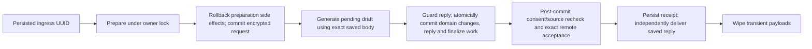

# Durable conversation history

OCH3 implements [ADR 0003](adr/0003-accepted-conversation-history.md) and the
[consumer contract](../contracts/second-context/conversation-history-v1.md) on the
existing Responses adapter. SecondContext owns the ordered transcript; Oria owns
preparation, current facts, consent, acceptance and channel delivery. This is an
optional lane: legacy processing remains the default. No provider database access,
new dependency, public schema change or automatic transcript-to-memory extraction
is introduced.

## Configuration and disclosure

Apply migration `0013`. Deploy ingress and workers with
`ORIA_POLICY_VERSION=2026-11-10.1` (also bump custom versions) and require fresh
acceptance. The old built-in policy versions are rejected at both entry points.
The new consent/privacy copy describes replay, prepared local exchanges, accepted
but undelivered replies, draft/accepted retention, linked erasure, cancellation and
optional OpenAI Decisions processing. Decisions observation/adaptive selection is
still provider-owned future work; this implementation sends only `recent/explicit`.

`SECOND_CONTEXT_HISTORY_ENABLED=false` is the default. Enabling it requires
`SECOND_CONTEXT_KNOWLEDGE_ENABLED=true` and its scoped service credential, since
active replies receive canonical natal facts. History readiness is checked through
`conversation-history-1`; source-bearing work also requires `linked-context-1`.
Health checks cannot substitute for either capability. Unsupported history never
silently falls back to legacy generation. Deployment and real-provider verification
remain OCH4/OCH5; changing examples/default disclosure does not update a running site.

Source-dependent capture waits for acknowledged current projections. A first active
turn may stage the own-birth projection and return a local, uncaptured calculated
reading while post-commit projection recovery delivers it. Pending/stale sources
or selective erasure suppress remote generation/replay immediately. A general
follow-up without usable sources receives the existing temporary-unavailability
reply; it does not claim to have been remembered.

## Transactions and retries

The initial preparation pass uses a savepoint. On reaching generation it rolls back
local learning/projection/clarification changes, then commits only the prepared
request and its session mapping. A second transaction repeats domain processing
and uses the saved request. Retries never reconstruct its model body, time, facts
or source references. Current consent, canonical profile revision, every linked
source and the session fence are rechecked before using saved work. Canonical
mutation cannot be committed merely to freeze a request.

The ingress event UUID is the turn ID. `conversation_history_work` has one row per
event, scoped to its owner/session/consent revision, with these phases:

| Phase | Durable state |
| --- | --- |
| `prepared` | Encrypted immutable request; provider result may be ambiguous |
| `finalize` | Domain changes, saved reply and encrypted exact acceptance committed |
| `accepted` | Validated exact receipt; saved reply awaiting independent delivery |
| `abandon` | Text erased; only scoped cancellation/expiry bookkeeping remains |
| `terminal` | Text erased; optional payload-free receipt/delivery bookkeeping |

Prepared and finalize envelopes use AES-256-GCM with separate owner/event/kind/key
version bindings. Replies retain the existing event envelope. No local transcript
archive is added. Receipt metadata contains no message text; owner rows are removed
by account deletion. Event completion, cancellation or terminal expiry wipes payloads.
Five attempts and the original 24-hour ingress expiry cover the entire workflow;
finalization and delivery never receive a fresh attempt/retention budget.

Before finalization, its attempted marker commits separately. Lost acknowledgements
retry the exact saved acceptance body, never another generation. A valid receipt
must match owner/session/turn/action/response and linked-history coverage. After
final exhaustion, acceptance can remain uncertain; Oria does not report rejection
or fabricate a new reply. Minimal abandonment identifiers survive until exact
acknowledgement or the conservative remote 24-hour pending expiry, with up to
60 seconds of allowance for the call starting after its durable attempt marker. Recovery runs
from PostgreSQL without Redis, current consent or capture enablement. It never
reports an accepted turn as successfully abandoned.

Delivery has independent `not_attempted`, `unknown`, `failed`, `sent` and `cancelled`
state. `unknown` commits before sending; explicit Telegram rejection is `failed`,
while transport failure/crash remains ambiguous. Retry sends the saved reply. A
successful Telegram call can still be duplicated after a crash; exactly-once sends
and provider execution are not promised. Terminal unconfirmed delivery marks future
prepared instructions so the model cannot assume the user read an accepted reply.
Accepted dialogue remains remotely eligible despite channel failure.

## Eligibility and lifecycle

Only the active conversational service generates managed turns. Deterministic
consumers can explicitly capture prepared local calculated answers through the same
acceptance lane; `capture_local` also supports an explicitly selected ordinary
conversational answer/question. It is not a blanket handler wrapper. Birth clauses
are prepared locally, and private temporal/record continuations, onboarding, saved
profile displays/edits, policy/help/privacy, memory controls, mutation receipts,
secrets, errors and status replies are excluded. Mixed save-receipt/readings stay
local and uncaptured. Replaced model drafts are finalized with the approved reply;
application snapshot labels are included in that exact reply. No replacement gains
new canonical dependencies.

Ordinary events remain ordered. Privacy/inspection/consent/deletion controls and
bounded answers to existing controls have a separate ordered bypass of a stuck
conversation head (including the backlog cap). Owner locks still serialize actual
operations. Waiting behind history cleanup consumes no generation attempts.

Withdrawal atomically cancels pending history work and wipes its input/reply/finalize
payloads. Consent revisions prevent reacceptance from reviving it. Canonical source
correction/erasure similarly cancels old work and invalidates the session mapping.
A new event rotates the session UUID only after old work resolves and current
projections/erasure are acknowledged; old transcript/payloads are never migrated.
Full deletion cancels work at confirmation and removes the new owner rows during
local cleanup, before the existing subject purge acknowledgement.

Disabling capture or LLM processing cancels prepared generation. Already committed
acceptance/delivery continues under current consent and source checks, including
when rolling back to legacy mode. Required abandonment and erasure continue.
Withdrawal and deletion always take precedence. Disabling is not remote forgetting.

Migration downgrade refuses while nonterminal history work exists. Resolve it using
compatible code first; rollback by disabling capture preserves recovery and fences.
See [verification evidence](evidence/conversation-history-workflow.md). Synthetic
consumer checks establish transactions and wire handling, not live provider replay
quality or a deployed release.
